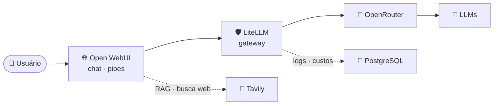

<!-- ══════════════════════════════════════════════════════════════════════
     ✦ ASTERIUZ · README de perfil — github.com/Asteriuz
     Paleta derivada do logo (cometa): carvão #222222 · vermelho #FF3131
     branco #FFFFFF · tint #FF8585 · off-white #EDEDED
     Pontos que exigem ajuste estão marcados com "✏️ EDITE".
     ══════════════════════════════════════════════════════════════════════ -->

<samp><b>Desenvolvedor &amp; Arquiteto de Soluções de IA</b></samp> 
<samp>Construindo infraestrutura de IA self-hosted 
RAG · LLM Ops · Automação 
Docker · Python · Open Source 
Full stack de base, IA de missão</samp>

<samp>✦ ────────────── ✧ ────────────── ✦</samp>

Sou o <b>Asteriuz</b> — desenvolvedor e arquiteto de soluções de IA. 
Vim do universo <b>full stack</b> (Flutter · React · UI/UX) e hoje construo o meu: 
<b>infraestrutura self-hosted</b>, automação e organização de ponta a ponta. 
Cada projeto é um cometa — direção clara, rastro de código.

<h2 align="center">🚀 Projeto em destaque · asteriuzLab</h2>

<samp>Uma VPS, um <code>compose up</code> — e o laboratório no ar</samp>

<!-- ✏️ EDITE: quando o asteriuzLab ficar público, descomente o card abaixo — o pin do repo se torna o destaque visual da seção.

-->

| 🌐 **Open WebUI** | 🛡️ **LiteLLM** |
|:---:|:---:|
| *front de chat com pipes customizados* | *gateway único · logs · custos por modelo* |
| 🔎 **Tavily** | 🐘 **PostgreSQL** |
| *busca web injetada na conversa* | *métricas por usuário · modelo · dia* |

<h2 align="center">🧩 Áreas de atuação</h2>

<!-- ✏️ EDITE: quando os repositórios dos projetos abrirem, transforme os títulos dos cards em links. -->

<table>
<tr>
<td align="center" width="50%">

### 🩺 Anamnesis · scribe clínico

API que transforma transcrições de consulta em **prontuários estruturados em PDF** — via Pipe do Open WebUI + Gotenberg.

</td>
<td align="center" width="50%">

### 🚗 Dados automotivos · qualidade de RAG

Coleta automatizada de manuais em PDF, extração de fichas técnicas via LLM e **benchmark de acerto de RAG** (com KB vs. puro vs. web).

</td>
</tr>
<tr>
<td align="center" width="50%">

### 👕 Guarda-roupa inteligente

Pipeline de **ingestão → extração → revisão** com LLM para catalogar sem digitar nada.

</td>
<td align="center" width="50%">

### 💰 Custos de IA

Métricas por **usuário · modelo · dia**, extraídas direto do PostgreSQL do LiteLLM.

</td>
</tr>
</table>

<h2 align="center">🛠️ Tech Stack</h2>

<i>A base full stack não foi apagada — só entrou em órbita em torno da IA.</i>

<h2 align="center">📊 Métricas em órbita</h2>

<!-- Opcional: remova include_all_commits/count_private para exibir apenas o histórico público. -->

 

Números buscados ao vivo — nada aqui é escrito à mão.

<h2 align="center">🐍 A cobra e as estrelas</h2>

<!-- A animação é gerada por GitHub Action no branch "output" (Platane/snk).
     Se as imagens não carregarem, rode o workflow da cobra. -->

<picture>
  <source media="(prefers-color-scheme: dark)" srcset="https://raw.githubusercontent.com/Asteriuz/Asteriuz/output/github-contribution-grid-snake-dark.svg" />
  <source media="(prefers-color-scheme: light)" srcset="https://raw.githubusercontent.com/Asteriuz/Asteriuz/output/github-contribution-grid-snake.svg" />
  
</picture>

A serpente cruza o meu céu de commits, engolindo uma estrela de cada vez.

<h2 align="center">🤝 Como me encontrar</h2>

Aberto a conversas sobre IA self-hosted, RAG e automação — ou sobre outros laboratórios caseiros.

<samp>✦ ────────────── ✧ ────────────── ✦</samp>

Feito à mão, cometa por cometa — Python, Docker e café. 
Se algo por aqui brilhou, deixe uma ⭐ — constelações se constroem juntas.

