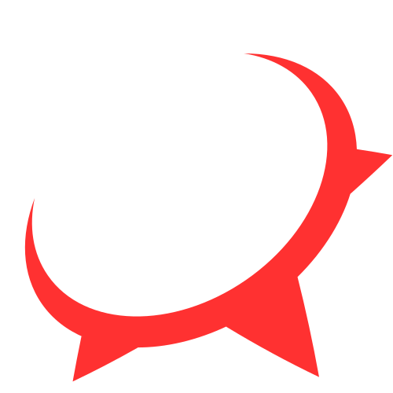
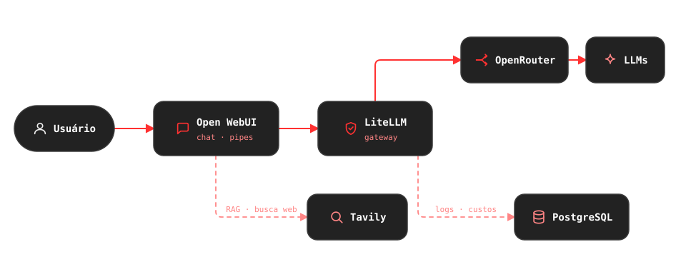

<!-- ══════════════════════════════════════════════════════════════════════
     ✦ ASTERIUZ · README de perfil — github.com/Asteriuz
     Paleta derivada do logo (cometa): carvão #222222 · vermelho #FF3131
     branco #FFFFFF · tint #FF8585 · off-white #EDEDED
     Pontos que exigem ajuste estão marcados com "✏️ EDITE".
     ══════════════════════════════════════════════════════════════════════ -->

<samp><b>Desenvolvedor &amp; Arquiteto de Soluções de IA</b></samp> 
<samp>Infraestrutura de IA self-hosted · RAG · LLM Ops · Automação</samp>

<samp>✦ ────────────── ✧ ────────────── ✦</samp>

&nbsp;

Sou o <b>Asteriuz</b>. Vim do universo <b>full stack</b> (Flutter · React · UI/UX) 
e hoje levo essa base à órbita da IA, construindo cada laboratório de ponta a ponta. 
Cada projeto é um cometa — direção clara, rastro de código.

&nbsp;

<h2 align="center"> Projeto em destaque · AsteriuzLab</h2>

<samp>Uma VPS, um <code>compose up</code> — e o laboratório no ar</samp>

 

 

<!-- ✏️ EDITE: quando o asteriuzLab ficar público, descomente o card abaixo — o pin do repo se torna o destaque visual da seção.

-->

|  **Open WebUI** |  **LiteLLM** |
|:---:|:---:|
| *front de chat com pipes customizados* | *gateway único · logs · custos por modelo* |
|  **Tavily** |  **PostgreSQL** |
| *busca web injetada na conversa* | *métricas por usuário · modelo · dia* |

&nbsp;

&nbsp;

 

<h2 align="center"> Áreas de atuação</h2>

<!-- ✏️ EDITE: quando os repositórios dos projetos abrirem, transforme os títulos dos cards em links. -->

<table>
<tr>
<td align="center" width="50%" height="200">

### Anamnesis · scribe clínico

API que transforma transcrições de consulta em **prontuários estruturados em PDF** — via Pipe do Open WebUI + Gotenberg.

</td>
<td align="center" width="50%" height="200">

### Dados automotivos · qualidade de RAG

Coleta automatizada de manuais em PDF, extração de fichas técnicas via LLM e **benchmark de acerto de RAG** (com KB vs. puro vs. web).

</td>
</tr>
<tr>
<td align="center" width="50%" height="200">

### Guarda-roupa inteligente

Pipeline de **ingestão → extração → revisão** com LLM para catalogar sem digitar nada.

</td>
<td align="center" width="50%" height="200">

### Custos de IA

Métricas por **usuário · modelo · dia**, extraídas direto do PostgreSQL do LiteLLM.

</td>
</tr>
</table>

&nbsp;

<h2 align="center"> Tech Stack</h2>

<i>A base full stack não foi apagada — só entrou em órbita em torno da IA.</i>

&nbsp;

<h2 align="center"><!-- TODO: substituir por img/icons/cometa-*.svg --> Métricas em órbita</h2>

<!-- Opcional: remova include_all_commits/count_private para exibir apenas o histórico público. -->

 

<i>Números buscados ao vivo — nada aqui é escrito à mão.</i>

&nbsp;

<h2 align="center"><!-- TODO: substituir por img/icons/cometa-*.svg --> A cobra e as estrelas</h2>

<!-- A animação é gerada por GitHub Action no branch "output" (Platane/snk).
     Se as imagens não carregarem, rode o workflow da cobra. -->

<picture>
  <source media="(prefers-color-scheme: dark)" srcset="https://raw.githubusercontent.com/Asteriuz/Asteriuz/output/github-contribution-grid-snake-dark.svg" />
  <source media="(prefers-color-scheme: light)" srcset="https://raw.githubusercontent.com/Asteriuz/Asteriuz/output/github-contribution-grid-snake.svg" />
  
</picture>

<i>A serpente cruza o meu céu de commits, engolindo uma estrela de cada vez.</i>

&nbsp;

<h2 align="center"> Como me encontrar</h2>

<i>Aberto a conversas sobre IA self-hosted, RAG e automação — ou sobre outros laboratórios caseiros.</i>

&nbsp;

<samp>✦ ────────────── ✧ ────────────── ✦</samp>

<i>Feito à mão, cometa por cometa — Python, Docker e café.</i> 
<i>Se algo por aqui brilhou, deixe uma ⭐ — constelações se constroem juntas.</i>

